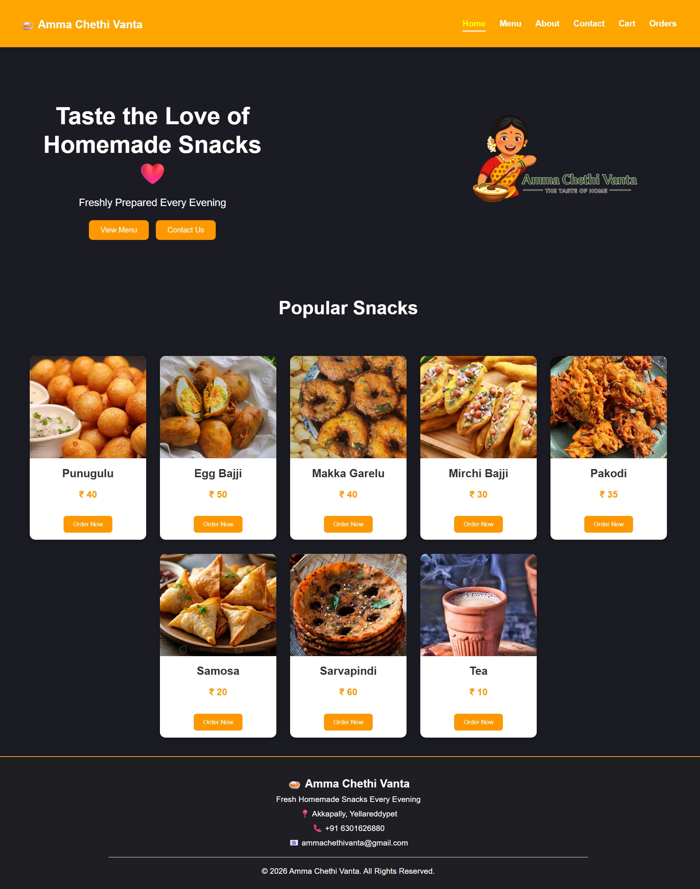
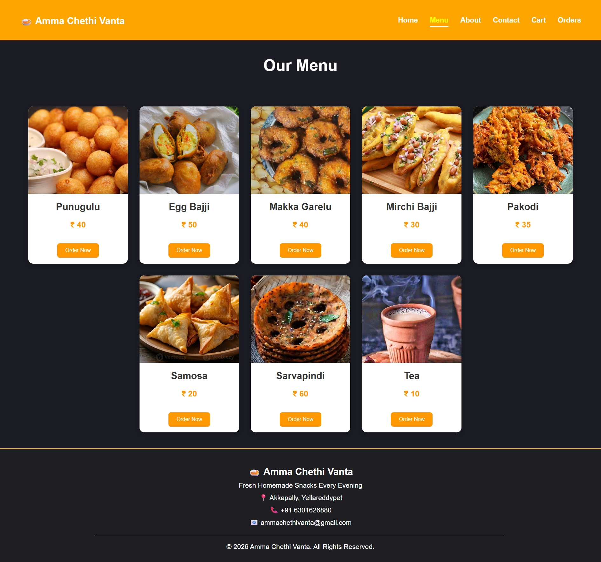
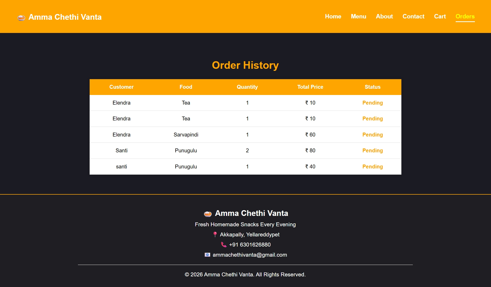

# Amma Chethi Vanta - Frontend

A responsive food ordering web application built using React and Vite.

## Live Demo
https://amma-chethi-vanta.vercel.app

## Backend API
https://amma-chethi-vanta-backend.onrender.com

## Tech Stack
- React.js
- Vite
- Axios
- CSS

## Features
- Home Page
- Popular Snacks
- Menu
- Food Details
- Place Order
- Responsive Design

## Screenshots

# Home Page

# Menu Page

# Order Page

## Backend Repository
https://github.com/SantiElendra15/amma-chethi-vanta-backend

## Author
Santi Elendra
